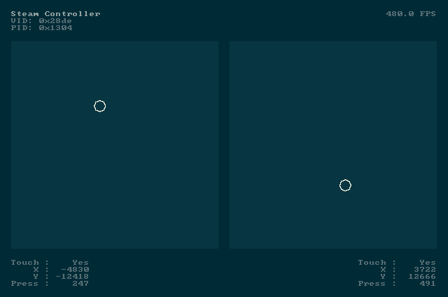

# trackpadtest

Test the trackpads on a Steam Controller.



## Download

Windows and Linux binaries are provided on the [Releases](https://github.com/ceski-1/trackpadtest/releases/latest) page. To build from source, see [Compiling](#compiling).

## Compiling

Requirements:

- [CMake](https://cmake.org) (3.16 or later)
- [SDL3](https://github.com/libsdl-org/SDL) (3.5.0 or later)

For Windows, [vcpkg](https://github.com/microsoft/vcpkg) is recommended. For Linux, use the libraries provided by your distribution.

Clone the repository:

```
git clone https://github.com/ceski-1/trackpadtest.git
```

Configure (if using vcpkg):

```
cmake -B build -DCMAKE_TOOLCHAIN_FILE="<path_to_vcpkg>/scripts/buildsystems/vcpkg.cmake"
```

Configure (if not using vcpkg):

```
cmake -B build
```

Build:

```
cmake --build build --config Release
```
